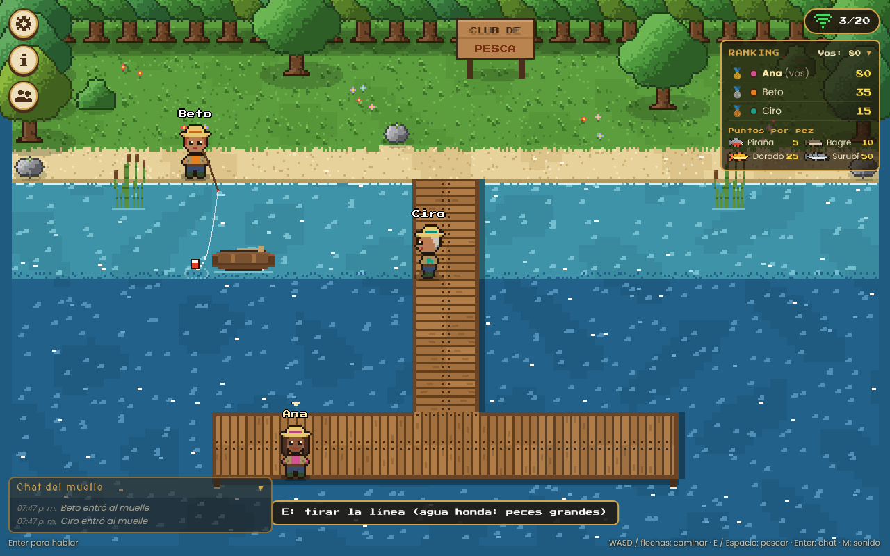
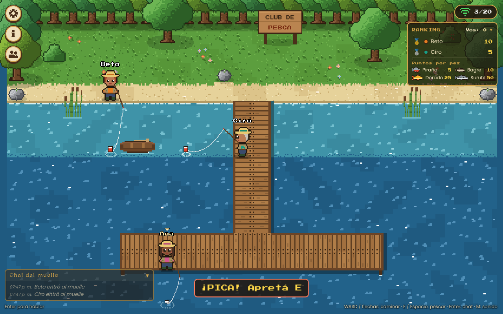

# 🎣 Muelle de Pesca

Trabajo práctico de **Programación IV** (TUP UTN). Es un juego web multijugador en pixel art, para PC o celular. Elegís **pescador o pescadora**, caminás por la playa y el muelle, tirás la línea y sacás **surubíes, dorados, bagres y pirañas**. Cada pez vale puntos y hay un **ranking** en vivo.

Está hecho con **Laravel 13 + Laravel Reverb** (servidor WebSocket) y **Laravel Echo** en el navegador. El muelle, los personajes y los peces están dibujados por código.

| En el muelle | ¡Pica! |
|---|---|
|  |  |

---

## 1. Qué necesitás

| Programa | Versión | Para qué |
|---|---|---|
| **XAMPP** | con **PHP 8.4 o más** | PHP y MySQL (y Apache para publicar) |
| **Composer** | 2.x | Dependencias de PHP |
| **Node.js** | 20 o más | Dependencias de JS y Vite |
| Git Bash | (viene con Git) | Para `publicar.sh` |

> Laravel 13 usa componentes de Symfony 8, que piden **PHP 8.4**. Con una versión anterior, `composer install` falla o aparece *"Composer detected issues in your platform: … require a PHP version >= 8.4.1"*. Fijate con `php -v`. Si XAMPP trae PHP 8.2, hay que actualizarle el PHP (bajar el **Thread Safe x64** de windows.php.net y reemplazar `C:\xampp\php`, conservando el `php.ini` con las extensiones `pdo_mysql`, `mbstring`, `openssl`, `fileinfo`, `curl`, `zip`, `intl` y `sodium`).

## 2. Instalar (una sola vez)

1. Descomprimí el proyecto en `C:\xampp\htdocs\muelle-pesca`.
2. En el panel de XAMPP prendé **MySQL**.
3. En una terminal, dentro de la carpeta, ejecutá:

   ```bash
   composer run setup
   ```

   El comando instala todo:
   - `composer install`;
   - crea el `.env`, la `APP_KEY` y las claves de Reverb (`php artisan muelle:claves-reverb`);
   - crea la base `muelle_pesca` con sus tablas;
   - corre `npm install` y `npm run build`.

## 3. Jugar

Abrí **tres terminales** en la carpeta del proyecto:

```bash
php artisan serve          # la app → http://127.0.0.1:8000
php artisan reverb:start   # el servidor WebSocket (puerto 8080)
npm run dev                # Vite
```

1. Entrá a **http://127.0.0.1:8000**, poné tu nombre, elegí **Pescador** o **Pescadora** y el color de la campera. Para probar con varios, abrí otras ventanas **de incógnito**.
2. Caminá hasta el borde de la playa o del muelle y **mirá hacia el agua**: abajo aparece *"E: tirar la línea"*.
3. Apretá **E** (o Espacio). La boya cae al agua y hay que esperar.
4. Cuando la boya **se hunde** y aparece **¡PICA!**, apretá **E** otra vez, rápido:
   - si recogés **antes** de que pique, el pez se asusta;
   - si tardás más de 1,5 segundos, **se escapa**;
   - a tiempo, el pez sale saltando y suma sus puntos.

| Pez | Puntos | En la orilla | En lo hondo |
|---|---|---|---|
| Piraña | 5 | 55 % | 35 % |
| Bagre | 10 | 35 % | 30 % |
| Dorado | 25 | 9 % | 23 % |
| Surubí | 50 | 1 % | 12 % |

**Lo hondo** es el agua oscura: se llega por el muelle, hasta la "T" del final. Desde la playa se pesca en la orilla.

**Controles:** WASD o flechas · **E / Espacio** pescar · **Enter** chat · **M** sonido. En el celular aparecen un d-pad y los botones 🎣 y 💬.

## 4. Cómo funciona (para la defensa)

```
Navegador ──HTTP: tirar la línea, recogerla, ranking, chat────────► Laravel (el ÁRBITRO)
    ▲                                                                   │ eventos ShouldBroadcast
    │ WebSocket (Echo)                                                  ▼
    └──────────────────────────────────────────────────── Reverb :8080 ◄┘
          canal de PRESENCIA "muelle"
          • here / joining / leaving          → quién está (cupo 20)
          • whisper 'mover' / 'estoy'          → los pasos (directo, sin Laravel)
          • whisper 'linea'                    → la caña de los demás (solo decorado)
          • .PezCapturado / .MensajeEnviado    → los emite Laravel
```

### El patrón del apunte

Cada acción importante sigue el camino del ejemplo de la cátedra:

1. El navegador hace un pedido HTTP.
2. Laravel valida y decide.
3. Laravel emite un evento `ShouldBroadcast`.
4. Reverb lo reparte.
5. Echo lo recibe con `.listen('.NombreDelEvento')`.

| Acción | Pedido | Evento | Qué reciben los demás |
|---|---|---|---|
| Tirar la línea | `POST /lances` | — | (solo la respuesta: cuándo pica) |
| Recoger | `POST /lances/{id}/recoger` | `PezCapturado` (si sacó algo) | Quién, qué pez, su total y el **ranking nuevo** |
| Ver el ranking | `GET /ranking` | — | (al entrar) |
| Chatear | `POST /chat` | `MensajeEnviado` (`toOthers()`) | El mensaje |

`PezCapturado` va a **todos**, también al que pescó: así el ranking se actualiza igual en todas las pantallas.

### ¿Por qué el servidor es el árbitro?

Los pasos van por **whisper** porque son muchísimos y no deciden nada. Pero si el navegador decidiera qué pez sacaste, cualquiera podría mandar "saqué un surubí" desde la consola. Por eso:

- **Al tirar la línea, el servidor sortea el pez y el momento del pique** (`PescaService::lanzar`) y los guarda en la tabla `lances`. Al navegador le devuelve **solo el cuándo** (`muerde_en`), nunca el pez: se sabe recién al recogerlo.
- **Revisa que se pueda pescar desde ahí:** parado en un lugar caminable y mirando a una celda de agua (`MuelleService::zonaDePesca`). La zona (orilla u honda) cambia las chances.
- **Al recoger, compara la hora del servidor** con `muerde_en`: antes → *temprano*; después de la ventana (1,5 s) → *escapó*; en el medio → *capturado* y suma los puntos.
- **Una línea por vez y nada de trampas con dos clics:**
  - `DB::transaction()` + `lockForUpdate()` sobre el usuario al tirar: dos pedidos a la vez se procesan de a uno y el segundo recibe **409 "Ya tenés la línea en el agua"**;
  - el mismo lock sobre el lance al recoger: un doble clic no suma dos veces (**409**);
  - no se puede recoger la línea de otro (**403**);
  - entre un lance y otro hay que esperar 0,8 s (**429**).
- **Los puntos se suman en la base** con `increment('puntos', …)`: es un `UPDATE … SET puntos = puntos + 25`, no pisa nada aunque lleguen dos a la vez.
- **El reloj es el del servidor:** cada respuesta trae su hora (`ahora`, en ms) y el navegador corrige la diferencia con el suyo para hundir la boya en el momento justo.
- **Milisegundos:** las columnas de horarios son `timestamp(3)` y el modelo usa `$dateFormat = 'Y-m-d H:i:s.v'`. Sin eso, Laravel guarda segundos enteros y la ventana de 1,5 s no se podría controlar.

### Dónde está cada tema en el código

| Tema | Dónde |
|---|---|
| Eventos `ShouldBroadcast` (`broadcastOn`, `broadcastAs`, `broadcastWith`) | `app/Events/` |
| Reglas de la pesca, transacciones y `lockForUpdate` | `app/Services/PescaService.php` |
| Desde dónde se puede pescar | `app/Services/MuelleService.php` |
| Controlador flaco | `app/Http/Controllers/LanceController.php` |
| Validación | `app/Http/Requests/` |
| Autorizar el canal de presencia | `routes/channels.php` |
| Echo: `join`, `here`/`joining`/`leaving`, `listen`, whispers | `resources/js/juego/red.js` |
| La caña del lado del navegador (fases, boya, salto del pez) | `resources/js/juego/pesca.js` |
| Ranking y tabla de puntos | `resources/js/juego/ui/ranking.js` |
| Peces, puntos y chances en un solo lugar | `config/pesca.php` |

## 5. Tests

```bash
php artisan test       # SQLite en memoria
composer test:mysql    # la misma suite contra MySQL (muelle_pesca_test)
php artisan pint       # formato del código
```

`tests/Feature/PescaTest.php` prueba las reglas: el pez no se revela al tirar, temprano / a tiempo / tarde, una línea a la vez, no recoger dos veces ni la línea de otro, la espera entre lances, el ranking y que en lo hondo salgan peces más grandes.

## 6. Publicar para jugar con amigos

Para que entren desde sus casas o celulares, usá **Apache de XAMPP + Cloudflare Tunnel** con `./publicar.sh` (puerto **8084**). Está todo explicado en **[PUBLICAR.md](PUBLICAR.md)**.

## 7. Créditos

- Muelle, personajes y peces: pixel art generado por código.
- Sonidos: WebAudio, sin archivos.
- Fuentes: Poppins, Press Start 2P y MedievalSharp (licencia OFL, vía Fontsource).
